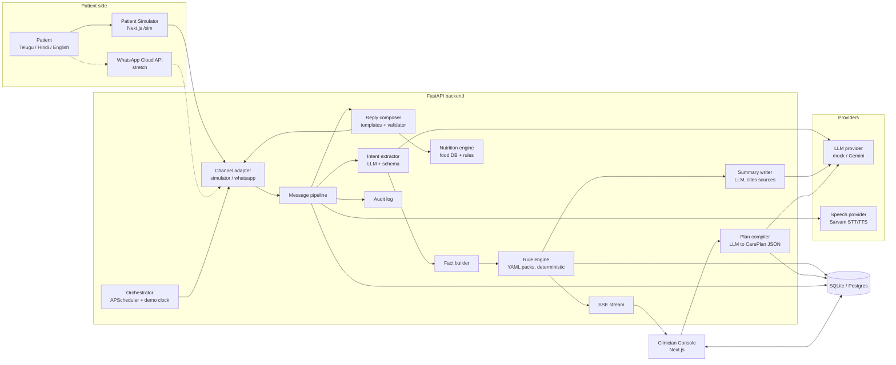
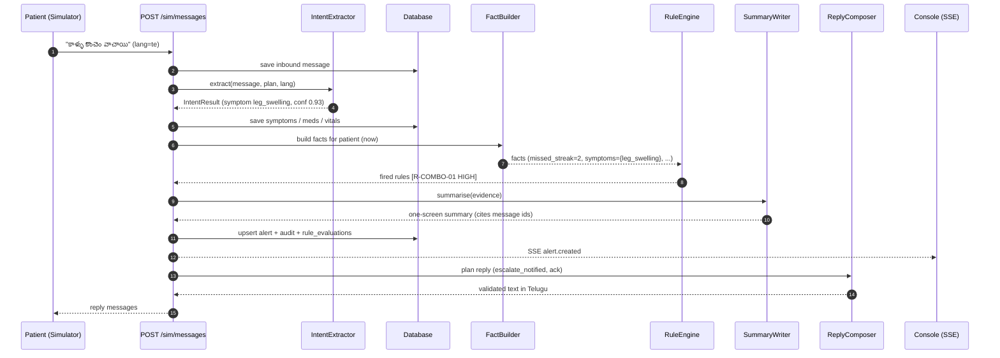

# 02 · System Architecture — Setu

## 1. Principle

> **Clinician-authored rules decide. AI handles language.**
> LLMs extract, translate and summarise. A deterministic rule engine decides who needs a human.

## 2. Component view

## 3. Primary flow — patient message to clinician alert

## 4. Technology decisions

| Decision | Choice | Why | Alternative |
|---|---|---|---|
| Backend | FastAPI (Python) | Fast to build, typed, auto OpenAPI, team already uses it | Node/Express |
| DB | SQLite dev → Postgres deploy | Zero setup locally, same SQL | Supabase directly |
| ORM | SQLAlchemy 2 | Mature, works on both DBs | SQLModel |
| Scheduler | APScheduler (in-process) | No infra for a prototype | Celery + Redis |
| Live updates | SSE (sse-starlette) | Simpler than WebSockets, one-way is enough | WebSockets |
| LLM | Provider interface; `mock` default; Gemini real | Offline-safe demo; team has Gemini experience | Any LLM behind same interface |
| Speech | Sarvam Saaras (STT) + Bulbul (TTS), optional | Supports Telugu (te-IN) per Sarvam model docs | Google Cloud STT/TTS, Whisper |
| Channel | Simulator first, WhatsApp Cloud API adapter later | No approval dependency for the demo | Twilio WhatsApp |
| Frontend | Next.js + Tailwind + shadcn/ui | Fast, accessible components, strong agent familiarity | Vite + React |
| State/data | TanStack Query + SSE hook | Cache + live updates with little code | SWR |
| Charts | Recharts | Simple, React-native | Chart.js |
| Interop | FHIR R4 shaped export via `fhir.resources` (stretch) | Credibility with ABDM direction | — |

## 5. Environments

| Env | Backend | Frontend | DB | AI |
|---|---|---|---|---|
| Local dev | `uvicorn` :8000 | `next dev` :3000 | SQLite file | mock |
| Demo (laptop) | same | `next build && next start` | SQLite | mock, with real optional |
| Hosted (optional) | Render / Cloud Run | Vercel | Postgres | Gemini |

## 6. Cross-cutting concerns

- **Demo clock** (`core/clock.py`): all time comes from one function with an adjustable offset. `POST /demo/time-travel` advances it and triggers due check-ins. This makes an 8-day story demo-able in 90 seconds.
- **Provider fallback:** every provider call has a timeout (LLM 8 s, speech 6 s). On failure → mock/deterministic fallback or human routing (SR-2).
- **Dedupe:** one open alert per `(patient, rule_id)` within a window; repeats update evidence and may raise severity.
- **Idempotency:** inbound messages carry a client message id; duplicates are ignored.
- **Auth (prototype):** two demo clinician accounts, JWT in an httpOnly cookie. The simulator uses a patient-scoped demo token. Not production auth.
- **CORS:** only the configured frontend origin.
- **Config:** pydantic-settings reading `.env`.

## 7. Failure modes

| Failure | Behaviour |
|---|---|
| LLM timeout / invalid JSON | One repair retry, then fallback `IntentResult(needs_human=true)` → LOW alert + clarify template |
| Rule pack fails to load | App refuses to start with a clear error (never run without rules) |
| Speech provider down | Voice button shows "Type instead"; text path unaffected |
| SSE disconnect | Console auto-reconnects and refetches queue |
| Duplicate webhook | Ignored via message id |
| Reply validator rejects LLM paraphrase | Fall back to the plain template text |
| Unknown language | Default to English template + LOW alert |

## 8. Security and privacy summary (details in docs/08)

Synthetic data only; no PHI in logs; secrets only in env; consent required before sending; audit trail on every decision; minimal data collected; delete-patient endpoint for demo reset.
