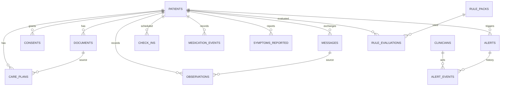

# 05 · Data Model — Setu

SQL is in `backend/db/schema.sql` (portable across SQLite and Postgres: JSON stored as TEXT, booleans as INTEGER 0/1, timestamps as ISO-8601 TEXT in UTC). SQLAlchemy models mirror it.

## 1. Entity overview



## 2. Tables (summary)

| Table | Purpose | Key columns |
|---|---|---|
| `clinicians` | Demo staff accounts | id, name, email, role, password_hash |
| `patients` | Synthetic patients | id (`P001`), name, age, sex, language, phone, location, conditions(JSON), discharge_date, status |
| `consents` | Consent evidence | patient_id, type, channel, text_version, granted, granted_at |
| `documents` | Raw discharge summaries | id, patient_id, kind, raw_text |
| `care_plans` | Versioned plans | id, patient_id, version, status, plan_json, warnings_json, source_document_id, created_by, approved_by, approved_at, activated_at |
| `messages` | All chat messages | id, patient_id, direction, channel, language, text, text_en, audio_url, template_key, intent_json, client_msg_id, created_at |
| `check_ins` | Scheduled prompts | id, patient_id, kind, scheduled_for, status, sent_at, answered_at |
| `medication_events` | Adherence per med per slot | patient_id, care_plan_id, med_id, date, slot, status, source_message_id |
| `observations` | Glucose, BP, weight | patient_id, type, value_num, value_num2, unit, context, recorded_at, source_message_id |
| `symptoms_reported` | Coded symptoms | patient_id, code, raw_text, severity_hint, negated, recorded_at, source_message_id |
| `alerts` | Clinician-facing alerts (one primary rule + contributing rules) | id, patient_id, severity, status, rule_id, rule_version, title, summary, facts_json, contributing_json, evidence_json, suggested_action, related_alert_id, due_by, … |
| `alert_events` | Alert history | alert_id, actor, action, note, at |
| `rule_packs` | Loaded packs | id, name, version, status, yaml_text, approved_by, approved_at |
| `rule_evaluations` | Why/when rules fired | patient_id, rule_pack_id, rule_id, rule_version, facts_json, fired, trigger_message_id, evaluated_at |
| `audit_log` | Everything important | actor, action, entity, entity_id, detail_json, at |
| `demo_clock` | Single-row demo clock | id=1, offset_seconds |

## 3. Controlled vocabularies

**Symptom codes** (the only values the extractor may emit):
`chest_pain, breathlessness, fainting, confusion, one_sided_weakness, slurred_speech, severe_headache, vision_change, leg_swelling, dizziness, excessive_thirst, frequent_urination, sweating_shaking, palpitations, nausea_vomiting, fever, foot_wound, reduced_urine, fatigue, other`

**Critical symptom set** (always CRITICAL by rule `R-CRIT-SYM-01`): `chest_pain, breathlessness, fainting, confusion, one_sided_weakness, slurred_speech`

**Observation types:** `glucose` (mg/dL), `bp` (mmHg; `value_num`=systolic, `value_num2`=diastolic), `weight` (kg)

**Medication slots:** `morning, noon, evening, bedtime` · **Frequency codes:** `OD, BD, TDS, HS, QID, PRN`

**Check-in kinds:** `morning (08:00 IST)`, `evening (19:00 IST)` · **Check-in status:** `pending, sent, answered, missed`

**Intents:** `greeting, medication_report, symptom_report, vital_report, meal_report, question, other`

## 4. CarePlan JSON (`care_plans.plan_json`)

```json
{
  "language": "te",
  "diagnoses": [
    { "name": "Type 2 diabetes mellitus", "code": "diabetes", "source_span": {"start": 120, "end": 150, "text": "Type 2 diabetes mellitus"}, "confidence": 0.98, "needs_review": false }
  ],
  "medications": [
    {
      "id": "med_metformin",
      "name": "Metformin",
      "strength": "500 mg",
      "form": "tablet",
      "dose_text": "500 mg twice daily after food",
      "frequency_code": "BD",
      "times": ["08:00", "20:00"],
      "timing_note": "after food",
      "criticality": "critical",
      "purpose": "diabetes",
      "source_span": {"start": 410, "end": 455, "text": "Tab Metformin 500 mg BD after food"},
      "confidence": 0.96,
      "needs_review": false
    }
  ],
  "monitoring": [
    { "type": "glucose", "frequency": "daily", "context": "fasting", "target_note": "As advised by your doctor", "source_span": {"start": 0, "end": 0, "text": ""}, "confidence": 0.9 },
    { "type": "bp", "frequency": "daily", "context": "morning", "target_note": "As advised by your doctor", "confidence": 0.9 }
  ],
  "diet": {
    "restrictions": ["low_salt", "limit_refined_sugar"],
    "goals": ["regular_meal_timing"],
    "notes": "Text copied from the discharge summary"
  },
  "activity": { "notes": "Light walking as tolerated" },
  "red_flags": [
    { "symptom_code": "chest_pain", "label": "Chest pain" },
    { "symptom_code": "breathlessness", "label": "Breathlessness" },
    { "symptom_code": "leg_swelling", "label": "New leg swelling" }
  ],
  "follow_ups": [ { "type": "clinic_visit", "due_date": "2026-11-01", "with": "Physician OPD" } ]
}
```
Rules: `dose_text` is verbatim; `criticality` ∈ {`critical`, `standard`}; `needs_review` is set automatically when confidence < 0.75 or `dose_text` is empty; `source_span.text` must exist in the source document.

## 5. IntentResult JSON (stored in `messages.intent_json`)

```json
{
  "language": "te",
  "intents": ["symptom_report"],
  "medication_events": [ { "med_id": null, "status": "missed", "slot": "morning" } ],
  "symptoms": [ { "code": "leg_swelling", "raw": "కాళ్ళు వాచాయి", "severity_hint": "mild", "negated": false } ],
  "vitals": [ { "type": "glucose", "value": 310, "unit": "mg/dL", "context": "fasting" },
              { "type": "bp", "systolic": 150, "diastolic": 95, "unit": "mmHg" } ],
  "meal": { "slot": "breakfast", "description": "idli", "foods": ["idli"] },
  "question": { "text": "Can I stop my tablet?", "category": "medical" },
  "confidence": 0.93,
  "needs_human": false
}
```

## 6. Alert lifecycle

```
open ──acknowledge──▶ acknowledged ──resolve──▶ resolved
  │                         │
  └────snooze──▶ snoozed ───┘ (returns to open when snoozed_until passes or severity rises)
```
- Every transition inserts into `alert_events` and `audit_log`.
- `resolve` requires a note.
- Snooze never applies to CRITICAL.

## 7. IDs and conventions

- Patients `P001…`, plans `CP-0001…`, alerts `A-0001…`, documents `DOC-0001…`, messages `M-<8 hex>`, check-ins `CI-<8 hex>`.
- Timestamps stored UTC; clock offset applied by `core.clock.now()`.
- Soft statuses, no hard deletes except the demo reset.

## 8. Seed data (in `/seed`)

| File | Content |
|---|---|
| `patients.json` | 5 synthetic patients across te/hi/en with varied risk |
| `discharge_summary_ramesh.txt` | Synthetic discharge summary for the hero patient |
| `scenario_ramesh.json` | Day-by-day scripted history and the live demo steps |
| `rules/diabetes_htn_v1.yaml` | Draft rule pack (**clinician review required**) |
| `rules/diabetes_htn_v1.tests.json` | Golden cases for the rule engine |
| `message_templates.json` | Approved-wording templates in en/te/hi (drafts until reviewed) |
| `foods_andhra.json` | Local food database (qualitative) |
| `eval_utterances.json` | Evaluation set for intent extraction |
